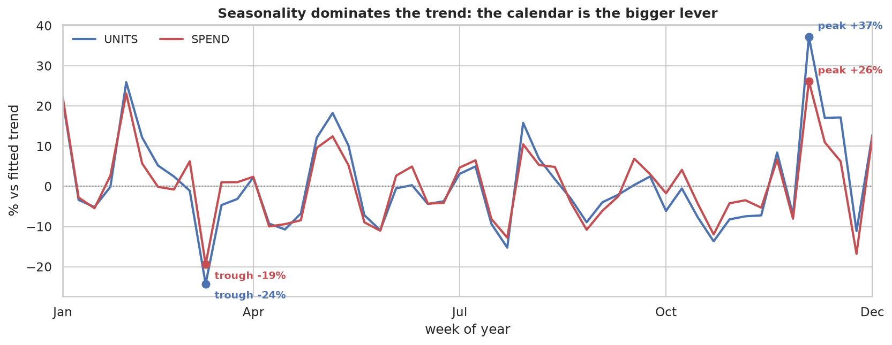

# How promos impact business?


### Price, promotion and basket economics across 77 US grocery stores, 2009–2012

A notebook-first analysis of a weekly **store × SKU** grocery panel — 524,950 records
of sales, price and promotion flags over 156 weeks. It asks what a promotion buys when
the unit is a household rather than a dollar: how much discount it takes to add one more
buying household, which kind of promotion does it, and whether that price survives the
calendar. The revenue-versus-discount ratio it used to lead with is still here, now
reported as a range, because the crediting rule moves it across break-even.

**The short answer for a category team:** promotions buy households, not bigger
baskets. Feature and display reach far more of them than a deeper silent discount, and
the calendar moves weekly demand more than any trend in the panel. A slide version,
[*Make the discount visible*](presentation/index.html), is included in the repository.


*Weekly totals indexed to the first week. Only `SPEND` gets a fitted line — +3.25%/yr,
season-adjusted p = 0.037. `UNITS` has no slope distinguishable from zero (−0.21%/yr,
p = 0.78), so the gap between the two lines is spend growth, not a volume decline.*

> [!IMPORTANT]
> The dataset carries **no customer identifier and no cost or margin field**. No household
> can be followed across weeks, so there are no LTV, retention or cohort curves —
> households appear only as per-row counts, which is enough to price the purchase of a
> buyer but not to follow one. And with no cost field, promotion economics stop at
> revenue against discount, never profit. Both limits shape what the notebooks claim, and
> both are stated where they bite rather than in a footnote.

The analysis is descriptive in the main. Inferential claims carry their test in the same
notebook section — HAC and rank trend tests, a permutation test, Fisher-z intervals with
Benjamini–Hochberg, a cluster bootstrap, paired tests — and where a number looks causal
(price elasticity most of all) the notebook says why it is not identified.

## Business insights

The panel is descriptive, so these are readings rather than recommendations. Each
carries the number behind it; the tests, intervals and caveats are in
[Findings](#findings), and the [current briefing](#the-briefing) follows the same
readings.

### 1. Promotions add households more than they deepen baskets

A promo week reaches **+76.5%** more buying households with the cell and the week held
fixed. That is the effect this panel measures most clearly; how deep the price cut goes
is the weaker of the two levers here. *(EDA §5.5)*

### 2. Visibility moves reach more than discount depth

Feature with display lifts reach **+220.1%**; a feature alone +87.9%, a display alone
+58.3%, and a temporary price cut on its own **+10.4%**. All pairwise differences
separate in this panel. Whether the pattern survives a holdout is untested. *(EDA §5.5)*

### 3. Reach costs less in some categories than others

One extra buying household costs **$1.27** in bag snacks and **$2.95** in frozen pizza,
and the four category intervals do not overlap. Reach is also concentrated: the largest
5% of store–SKU cells supply 29.2% of all incremental households. Within this retailer,
a fixed budget would buy more reach in the cheaper categories. *(EDA §5.5)*

### 4. Seasonality is large enough to distort a simple comparison

Seasonality carries **43.07%** of weekly unit variance against 6.83% for trend, and the
peak-to-trough swing is **81.21%**. A peak week and a trough week are therefore not a
like-for-like comparison; the same weeks last year, or a full year, are. *(EDA §3)*

### 5. Value grew while volume did not

Weekly spend grew **+3.25%/yr** while units did not (−0.21%/yr, p = 0.78). Paired within
store, spend per basket is up **+6.5%** (p = 6.4e-38) and units per basket down 0.72%
(p = 8.5e-09). A flat-volume, price-led base case is what the panel supports. *(EDA §2, §5.3)*

### 6. Margin data is the missing input

The same cells and the same $3.58M of discount return **0.86x**, **1.19x** or **1.34x**
incremental revenue depending on the crediting rule, and **$2.06** is the cost of one more
buying household with no benefit attached. With no cost field, a 20%-margin and a
60%-margin item score identically here, so contribution margin and COGS are what would
settle whether to scale. *(EDA §5.2, §5.5)*

> [!NOTE]
> The briefing closes on the same caution: **for reach, visibility; for clearance,
> price.** This panel can show the first. The second needs margin and inventory data it
> does not have.

## Data

| | |
| --- | --- |
| Source | <https://www.kaggle.com/datasets/frtgnn/dunnhumby-the-complete-journey> |
| File | `data/dunnhumby - Breakfast at the Frat.xlsx` (~31 MB, ~30 s to parse) |
| Panel | 156 weeks, 2009-01-14 → 2012-01-04, every week ending on a Wednesday |
| Coverage | 77 stores · 55 UPCs · 4 categories · 9 MSAs across 4 states |

Four sheets: `Glossary`, `dh Store Lookup`, `dh Products Lookup`, `dh Transaction Data`.

Parsing quirks — get these wrong and cells fail or silently misread:

- the three data sheets carry a title banner on row 1, so `header=1`; `Glossary` needs `header=3`
- `Glossary` parses with a junk `Unnamed: 3` column that has to be dropped
- `dh Store Lookup` ships 79 rows for 77 stores — `STORE_ID` 4503 and 17627 appear twice
  with conflicting `SEG_VALUE_NAME`, so `drop_duplicates("STORE_ID")` before any join
- the lookups describe 58 UPCs while 55 appear in transactions; this is a
  lookup-versus-facts mismatch, not a data error

> [!NOTE]
> `*.xlsx` is gitignored, so a fresh clone has **no data**. Download the workbook first
> and keep the filename exactly as written above — it contains spaces.

## Running the analysis

```sh
uv sync
cd notebooks && uv run jupyter lab
```

> [!IMPORTANT]
> Run Jupyter **from inside `notebooks/`**. Every notebook hardcodes
> `Path("../data/dunnhumby - Breakfast at the Frat.xlsx")`, which resolves against the
> working directory, so launching from the repo root silently breaks every data cell.

Python 3.14 · pandas 3.0 · seaborn · scipy · scikit-learn, managed with `uv`.

## The briefing

[`presentation/index.html`](presentation/index.html) is the current investor briefing,
*Make the discount visible — promotion economics*: eight slides, English and Russian in
one self-contained file, using the same numbers and charts as the notebooks.

- Open the file directly in a browser — no server or install is needed to read it.
- `←`/`→` move between slides, `L` switches language, `?lang=ru` opens the Russian deck,
  and `#s3` links a single slide.
- The browser's print dialog produces a 16:9 PDF, because the deck is styled for it.
- [`presentation/build_deck.py`](presentation/build_deck.py) recomputes every number and
  redraws every chart from the workbook: `uv run python presentation/build_deck.py`.
  Its console output is the deck's audit trail, and the build fails if either claim the
  deck states as prose stops holding.

## What is in here

| notebook | scope |
| --- | --- |
| `notebooks/0_prelim_analysis.ipynb` | shape, quality, coverage, referential integrity, first-order patterns |
| `notebooks/1_distribution_analysis.ipynb` | distribution of the six key metrics — which test and transformation each one justifies |
| `notebooks/EDA.ipynb` | trend, seasonality, store cohorts, and the metrics the panel can actually support |
| `notebooks/2_readme_figures.ipynb` | regenerates the five committed figures from the same data |
| `notebooks/3_claims_audit.ipynb` | static checks on cells, names, links and `§` references |

All notebooks ship unexecuted, so checking a number means running the cell rather than
reading the file. `3_claims_audit.ipynb` is the fast exception: it needs no data and
finishes in seconds.

## Findings

Each number below is printed by the section it cites; each chart is regenerated by
`2_readme_figures.ipynb` from the same data.

- **Value rises; volume does not.** Weekly `SPEND` trends +3.25%/yr and survives all three
  trend tests — HAC(4) p = 0.048, season-adjusted p = 0.037, Mann-Kendall p = 0.004.
  Weekly `UNITS` gives −0.21%/yr and fails all three (p = 0.92, 0.78, 0.82), so the 5.65%
  endpoint gap is two different seasons, not a decline. *(EDA §2)*
- **Seasonality dominates the trend.** The seasonal component carries 43.07% of `UNITS`
  variance against 6.83% for trend, swinging 81.21% peak to trough; for `SPEND` it is
  39.86% against 9.98%, swinging 56.57%. A permutation test puts both above the shuffle
  floor (p = 0.0050 and 0.0120). *(EDA §3)*



*The seasonal component of the weekly log series, phase-averaged over the panel's three
cycles. Read it as per cent above or below the fitted trend: units peak at +37% and trough
at −24%, spend at +26% and −19%. The 81.21% swing is the log-space peak-to-trough gap
converted back, which is why it exceeds the difference between the two annotated points.*

- **It repeats, but only moderately.** Across 52 paired ISO weeks, 9 of 15 strata have a
  2010-vs-2011 correlation whose 95% interval excludes zero, 8 survive Benjamini–Hochberg.
  `VALUE` leads at 0.521 [0.289, 0.695] while `MAINSTREAM` (0.179) and `UPSCALE` (0.218)
  straddle zero — so "the same week last year" works for some stores, not the mass market.
  *(EDA §4)*
- **Price is clearly elastic and not causally identified.** −0.79 pooled, −0.995 within
  UPC, −1.66 within UPC × store: the estimate moves as controls are added because price
  is set in response to demand, so no specification here isolates a causal elasticity.
  *(EDA §5.1)*
- **Assortment, not demand, moves UPC reach.** 8 of the 55 UPCs do not span the 156
  weeks: three KING frozen pizzas enter on 2010-02-24 and `COLG SPEARMINT WISP` is
  delisted on 2011-03-30 — the panel's one clean exit event. *(EDA §5.4)*
- **A promotion buys buyers, and the price cut is the weakest way to buy them.** A promo
  week reaches **+76.5%** more buying households with cell and week held fixed, at
  **$2.06** [$2.01, $2.11] per incremental household. Feature+display reaches +220.1%
  against +10.4% for TPR-only, and all pairwise differences separate. *(EDA §5.5)*

### Promotion economics

28.43% of store–SKU–week rows carry a promotion flag at a median discount depth of
19.05%. Across 3,857 paired SKU–store cells, the median promo week sells **1.83x** the
units and takes **1.48x** the spend of that same cell's non-promo weeks.


*Three crediting rules on the same $3.58M of discount and the same 3,857 cells: 0.86x
under the notebook's median-lift rule, 1.19x [1.16, 1.22] as a per-cell median, and
1.34x on observed promo spend. The direction of the verdict depends on which rule you
use.*

> [!WARNING]
> **0.86x is one crediting rule, not the answer.** The notebook reports three on the same
> cells and the same discount, and the direction of the verdict turns on which one you
> pick. The rule behind 0.86x multiplies a cross-cell *median* lift by a panel *mean*
> baseline, so it is neither the typical cell nor the panel total. None of the three is a
> profitability statement: the dataset has no cost field, and each charges the full shelf
> discount to every promo unit, including units that would not have sold at all. See
> `EDA.ipynb` §5.2.

### Household acquisition

Households, not revenue, are the unit this panel can actually price. Across 3,703 paired
SKU–store cells a promo week reaches **+76.5%** more buying households with cell and week
held fixed, and one more buying household costs **$2.06** [$2.01, $2.11] against $3.57M
of discount. The cost is not uniform:

| category | cost per incremental household |
| --- | --- |
| BAG SNACKS | $1.27 [$1.15, $1.41] |
| COLD CEREAL | $1.85 [$1.80, $1.90] |
| ORAL HYGIENE PRODUCTS | $2.77 [$2.69, $2.86] |
| FROZEN PIZZA | $2.95 [$2.91, $3.00] |

The four intervals do not overlap. Mechanism matters more than depth: measured within
cell and week, TPR alone buys +10.4% reach, display +58.3%, feature +87.9%, and feature
with display +220.1%. *(EDA §5.5)*


*Left: discount per incremental buying household by category, calendar-adjusted, with
cluster-bootstrap 95% intervals — $1.27 in bag snacks to $2.95 in frozen pizza. Right:
reach lift by promotion type with cell and week held fixed — TPR alone +10.4%, feature
and display together +220.1%.*

> [!WARNING]
> **$2.06 is a cost with no benefit attached.** There is no margin field, so it says what
> a household cost, not what it returned. The average is also volume-weighted — the
> largest 5% of cells supply 29.2% of the incremental households — so a small store
> should not read it as its own.

### Basket economics


*Median store-week, 2009–2011. Spend per basket rises $3.055 → $3.244 (+6.2%) while units
per basket falls 1.135 → 1.125.*

Baskets are not growing — they are getting more expensive. Pairing each store's 2009 and
2011 medians, the ticket is up $0.20 (+6.5%, p = 6.4e-38) and the basket is down 0.72%
(p = 8.5e-09): statistically certain, economically small. *(EDA §5.3)*

## Figures

The five PNGs in `figures/` are committed, because GitHub does not render notebook
outputs inside a README. They are generated by
[`notebooks/2_readme_figures.ipynb`](notebooks/2_readme_figures.ipynb), which re-draws
results from `EDA.ipynb` and prints every number quoted in the captions above. *Run All*
from `notebooks/` rewrites them; if a printed number disagrees with the section it cites,
the figure is stale.

## Limitations

- **No customer key anywhere.** `HHS` and `VISITS` are per-row counts, not IDs, so no
  household can be followed across weeks. Customer-level anything is not computable.
- **No cost, margin or COGS field.** Promotion economics stop at revenue. A 60%-margin
  and a 20%-margin item score identically here.
- **Promotions are scheduled, not randomly assigned.** Lifts are confounded with weeks
  the retailer already expected to be strong; there is no A/B test in this data.
- **One retailer, four categories, 77 stores, 2009–2012.** External validity is narrow.
- **2012 is a single week.** Per-year figures for 2012 should be read as noise.
- **Aggregation bias.** Market-level elasticities are compressed relative to
  household-level ones; the −0.79 … −1.66 range is consistent with that compression.

## Repository layout

```
.
├── notebooks/                     analysis; run from this directory
│   ├── 0_prelim_analysis.ipynb
│   ├── 1_distribution_analysis.ipynb
│   ├── EDA.ipynb
│   ├── 2_readme_figures.ipynb     regenerates the figures above
│   └── 3_claims_audit.ipynb       static checks, no data needed
├── figures/                       committed PNGs used by this README
├── presentation/                  investor briefing (EN/RU) and its build script
│   ├── template.html
│   ├── template.ru.html
│   ├── build_deck.py              recomputes every number in the deck
│   └── index.html                 generated, self-contained
├── data/                          put the .xlsx here (gitignored)
├── src/ecommerce_analysis/        not usable — see Status
├── pyproject.toml
├── uv.lock
└── AGENTS.md                      working notes and conventions for agents
```

## Status

No test suite, no linter or formatter config, no CI. Two notebooks stand in for them:
`notebooks/3_claims_audit.ipynb` compiles every cell, flags any name nothing defines, and
resolves every link and `§` reference; `notebooks/2_readme_figures.ipynb` re-prints each
number the captions quote. The numbers themselves are verified by re-running `EDA.ipynb`
and comparing the printed values with the prose — the standard the notebooks are written
to. `presentation/build_deck.py` carries the same audit trail for the deck.

`src/ecommerce_analysis/` is a leftover: its `__init__.py` imports a module deleted in
`4066928`, so `import ecommerce_analysis` raises `ModuleNotFoundError`. Nothing in the
analysis depends on it.
